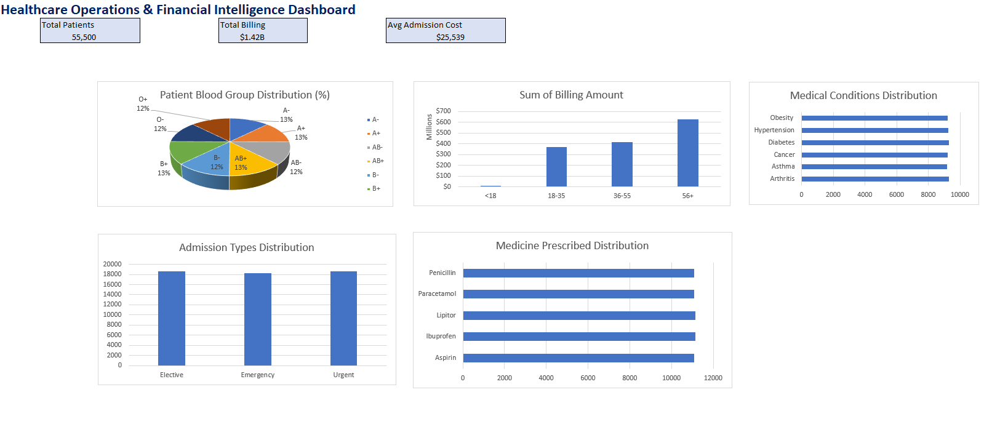

# Healthcare Operations & Financial Intelligence Dashboard

## Executive Summary
An executive-level Excel dashboard engineered from 55,000+ patient records to provide C-suite visibility into hospital operational resource allocation, patient demographics, and financial risk exposure. 

---

## Key Features & Business Insights
- **Top-Level KPI Summary Cards:** Instant visibility into key metrics, including **55,500 Total Patients**, **$1.42B Total Billing Revenue**, and **$25,539 Average Admission Cost**.
- **Financial Risk & Billing Tiers:** Categorized patient financial exposure using custom range lookups (`XLOOKUP`) and conditional evaluation rules (`IFS`).
- **Clinical & Resource Allocation:** Dynamic tracking across hospital admission types (*Elective*, *Emergency*, *Urgent*), top medical conditions, and pharmaceutical prescription trends.
- **Data Engineering & Hygiene:** Clean 3-tier architecture (`Raw_Data` → `Pivot_Engine` → `Dashboard`) with numeric type validation, dynamic range handling, and standardized chart baselines.

---

## Architecture & Technical Stack
- **Tool:** Microsoft Excel (`.xlsx`)
- **Key Formulas & Functions:** `XLOOKUP` (Approximate/Binary matching), `IFS`, `IFERROR`, `ISNUMBER`, custom number formatting (`$0.00,,,"B"`).
- **Data Modeling:** Multi-table Pivot Aggregations, Dynamic Slicers, UI/UX Container Design.

---

## How to Use
1. Download the workbook file: [`Healthcare_Operations_Dashboard.xlsx`](Healthcare_Operations_Dashboard.xlsx).
2. Open in Microsoft Excel.
3. Navigate to the **`Dashboard`** tab to view dynamic charts and interactive slicers.
